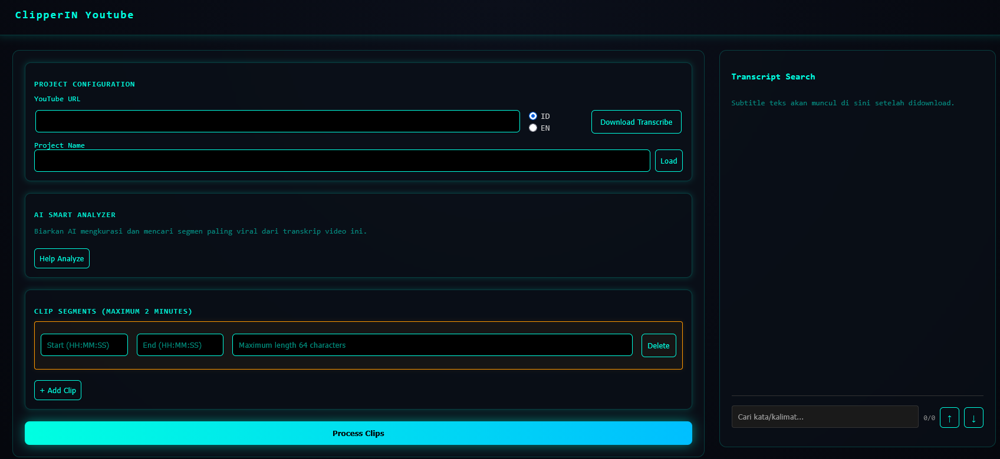
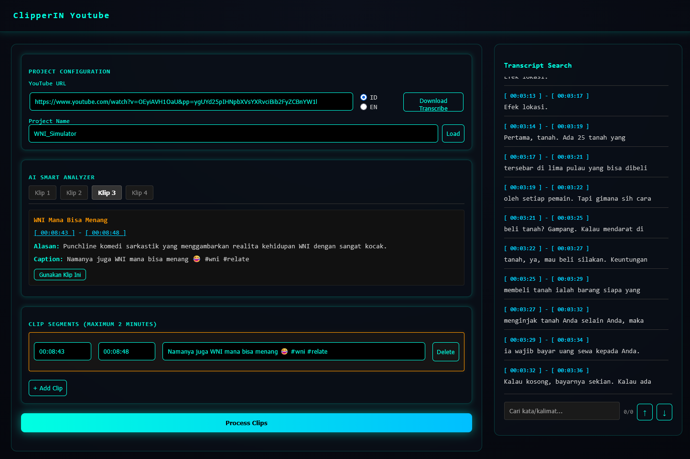
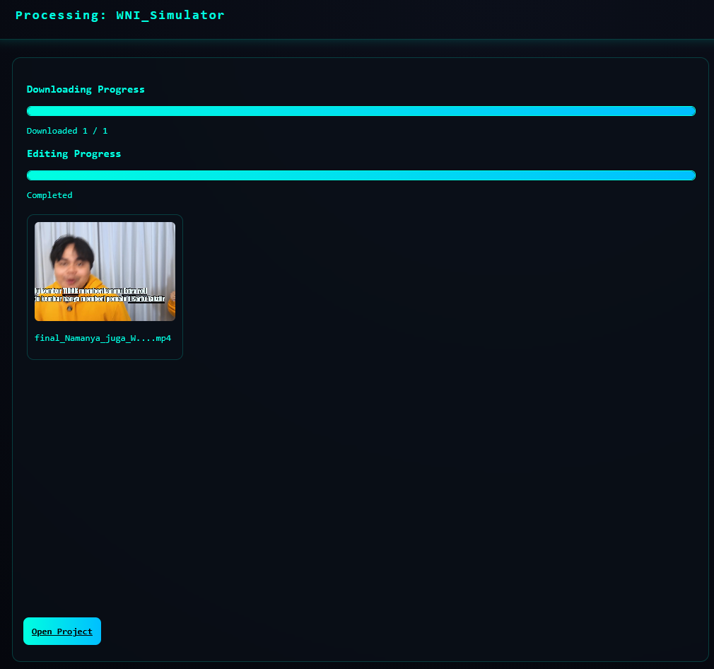
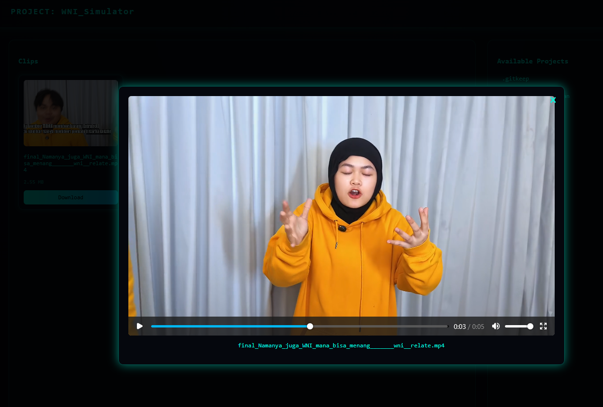

# Youtube Clipper

Tools potong-potong video youtube, untuk nantinya digunakan ke TikTok, Instagram Feed atau untuk kebutuhan masing-masing..


## Features

- Download transcribe dari youtube (pilihan bahasa Indonesia atau English)
- Search manual keyword untuk dapat range waktu di video
- Bantu analisa transcribe ke model AI untuk mencari potongan yang potensi petjah (AI Smart Analyzer)
- Clip video dan simpan ke folder Project
- Preview hasil clip video


## Run Locally

OS Version:
```bash
  cat /etc/os-release
  -- PRETTY_NAME="Ubuntu 24.04.5 LTS"
```

Install apache2 dan PHP

```bash
  sudo apt install apache2 -y
  sudo apt install php libapache2-mod-php php-cli php-curl php-mbstring php-xml php-zip -y
```

Download library yt-dlp 

```bash
  sudo wget https://github.com/yt-dlp/yt-dlp/releases/latest/download/yt-dlp_linux -O /usr/local/bin/yt-dlp_linux
  sudo chmod a+rx /usr/local/bin/yt-dlp_linux
  yt-dlp_linux --version
  -- 2026.08.19
```

Install ffmpeg

```bash
  sudo apt install ffmpeg -y
  ffmpeg -version
  -- ffmpeg version 6.1.1-3ubuntu5 Copyright (c) 2000-2023 the FFmpeg developers
```

Buat folder kerja dan masuk ke folder kerja

```bash
  mkdir -p /var/www/html/yt-clipper
  cd /var/www/html/yt-clipper
```

Configure apache2

```bash
  sudo vi /etc/apache2/sites-available/000-default.conf
  -- rubah DocumentRoot <before>
    DocumentRoot /var/www/html/
  
  -- DocumentRoot <after>
    DocumentRoot /var/www/html/yt-clipper
```

Clone project

```bash
  git clone https://github.com/raechaa/yt-clipper.git
```

Masuk ke folder kerja

```bash
  cd /var/www/html/yt-clipper
```

Configure .env file
(optional) digunakan untuk meminta bantuan AI dalam mencari klip potensi viral

```bash
  cp .env{.example,}
  vi .env
  -- sesuaikan API_KEY dan AI_MODEL
```

Start service apache2

```bash
  sudo systemctl start apache2
```
## Environment Variables

Untuk menggunakan fitur AI Smart Analyzer

`API_KEY`

`AI_MODEL`


## Screenshots







## Authors
- Credit to [@JayaWikrama](https://github.com/JayaWikrama) pada project [#ClipperIN](https://github.com/JayaWikrama/Prototype_ClipperIN.PHP)
